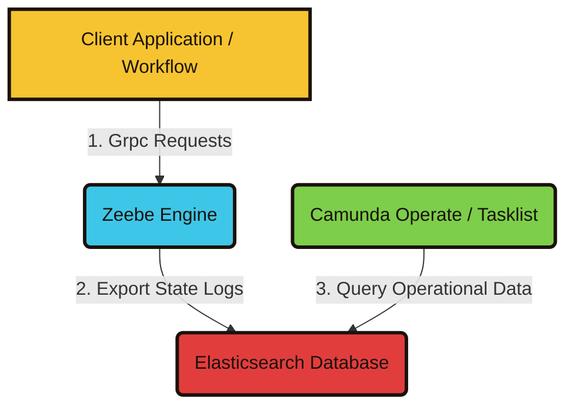

# Docker Compose in the Camunda Ecosystem

Docker Compose runs a group of containers from one YAML file. One command starts them, and one command stops them. In Camunda 8 Self-Managed, that file is how developers stand up a local cluster without wiring each service by hand.

The default Compose file starts the Orchestration Cluster and Connectors, with file-based H2 as the store. A fuller file adds Optimize, Camunda Hub, Management Identity, and the databases those components need. These files are for local development and evaluation. A production cluster belongs on Kubernetes with Helm. The Docker images themselves can run in production; the Compose files should not.

Two short guides continue from here:

- [Camunda 8 Run quickstart](./camunda-8-run-quickstart.md) is the path without containers: one archive and a start script.
- [Docker Compose quickstart](./docker-compose-quickstart.md) covers how to install, start, and stop the Compose distributions.

:::warning[THESE GUYS ARE GREEDY!]

Do not run both at the same time. They listen on the same ports, starting with `8080`.

:::

:::info[Press Ctrl+M to see the map]

Review the conceptual map above to understand how infrastructure components interact with each other.

Seriously, try it.

:::
