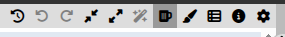
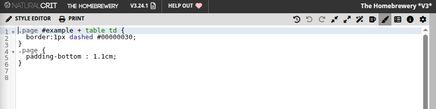
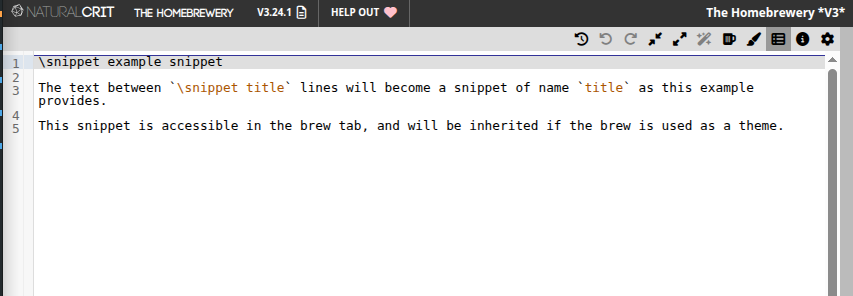
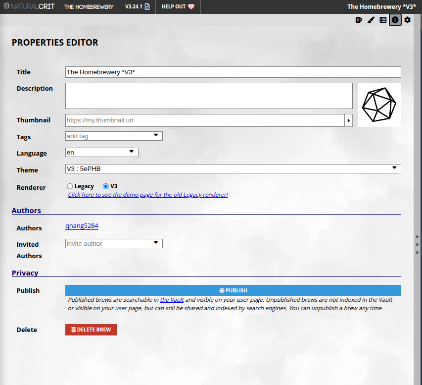
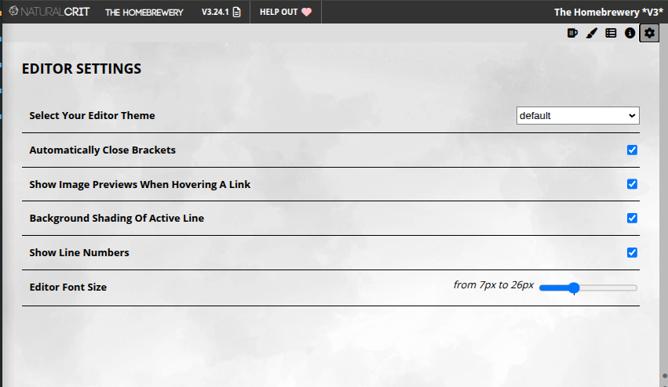

# 7. Editor tools

The snippet bar is more than snippet menus. Along it (and on the tabs at the right) sit tools that save you from lost work, tidy the source, and switch what you are editing. You do not need CSS to use any of these.

### History

The **clock** button. Homebrewery keeps **local backups** of this brew in the browser (up to five snapshots, from a few minutes old to a few days). Open **History** and click a snapshot to restore it.

Use this after an accidental select-all-and-type, a bad paste, or a tab that went wrong. Restore **before** you refresh if you still have Undo; History is the fallback when Undo is not enough. These copies live on **this computer**, not in the cloud.

### Undo

Steps backward through recent edits in the current editor (Brew or Style). The snippet-bar **Undo** button and **Ctrl+Z** / **Cmd+Z** do the same job. Mash it after you overwrite a selection.

### Redo

Steps forward again after Undo. Use the **Redo** button or **Ctrl+Y** / **Cmd+Shift+Z**. Switching Brew ↔ Style no longer wipes this stack.

### Fold All

Collapses every `\page` section in the source so you see a short outline instead of the full Markdown. Handy in a long module when you only need the chapter you are on. Shortcut: **Ctrl+[**.

### Unfold All

Expands every folded page again. Shortcut: **Ctrl+]**. Folding does not change the preview or the PDF; it only hides source until you unfold.

### Clean your Code

Formats the current editor with a standard layout (indentation and wrapping). On the **Style** tab this runs a CSS formatter (also **Ctrl+Shift+F** / **Alt+Shift+F**). Use it when a paste looks like one long line. It does not change how the brew *looks* in the preview unless you had a syntax error that the formatter happens to fix. Glance at the preview after you click it, then Undo if the result is not what you wanted.

### Brew Editor

The **mug** tab. This is the Markdown source: story, snippets, `\page`, tables. Stay here for almost all writing. The left pane you have used since [Start a new document](./start-a-new-document.md) **is** the Brew Editor. Click it if you are, for instance, working on a snippet and wish to go back to the Markdown editor.

### Style Editor

The **paintbrush** tab. This pane is **only CSS** for this brew: page size, colours, drop caps, ink-friendly print. Built-in **Print** and other style snippets insert here, not into the Markdown. You can ignore this tab and still finish a complete PHB-looking module. If you do open it, put custom rules here instead of burying `<style>` tags in the Brew Editor. This chapter will not teach CSS.

### Snippets

The **list** tab next to Style. This is where **you** define reusable bits (a house-style note, a custom stat-block stub). They then appear under a **Brew Snippets** menu on the snippet bar. Built-in PHB and Text Editor snippets do **not** live here; those menus are already filled. Widen the editor pane if Brew Snippets looks empty or clipped. Custom snippets can travel with a theme you share.

### Properties

The **i** (info) button. Metadata for **this brew**:

- **Title** and description (what appears on your user page and in search)
- **Tags** (including `meta:theme` if this brew is a theme for others)
- **Theme** dropdown (Blank, PHB, or another brew tagged as a theme)
- **Renderer:** keep **V3** for new work; Legacy is for old documents
- **Language** (hyphenation and spellcheck)
- Publish / share visibility for the Vault

Set the title early. Do not switch renderer mid-project unless you are ready to fix syntax.

### Settings

The **gear** (often on the preview side). This is **how you look at** the brew, not the brew’s content: single page vs facing pages vs a continuous “flow” view, **Sync views** (scrolling the editor and preview together), and **Hide** for the page strip. None of these change the PDF except insofar as they help you spot overflow before you export.
