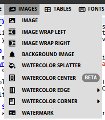
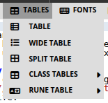
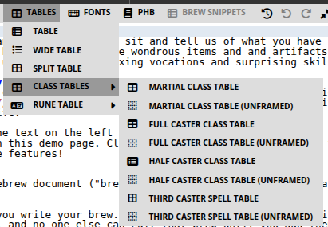
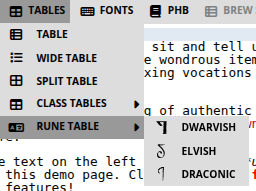
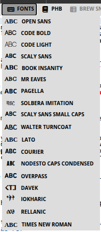
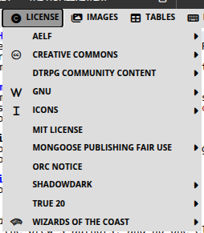

# 6. Images, Tables, Fonts and License

This chapter covers four snippet menus you will use after layout and PHB blocks are in place: **Images**, **Tables**, **Fonts**, and **License**, in that order. Insert them from the snippet bar the same way as before: cursor first, then the snippet, then replace placeholders.

### 6.1 Images



Homebrewery does not upload files from your disk. Every picture must be a **public URL**. You are responsible for the license on that art; pair sourced images with **PHB → Artist Credit**.

#### Image

The basic snippet: Markdown image plus a curly-brace style list.

```markdown
 {width:325px}
```

- **Alt text** in `![...]` — a short description if the URL fails.
- **URL** in `(...)` — a reachable link; a private or expired host shows a blank.
- `{width:...}` — size. Use `px`, `cm`, or `%` (`width:100%` fills the column).

#### Image Wrap Left / Image Wrap Right

Same as Image, with wrap already set so body text flows beside the picture. Put the snippet **before** the paragraphs that should wrap. PNG files with transparent backgrounds wrap more cleanly than photos with a hard rectangle.

```markdown
 {width:280px,margin-right:-3cm,wrapLeft}
```

`wrapRight` and `margin-left` mirror this on the other side. Tweak the margin so type does not crowd the art.

#### Background Image

Pins art to the **page**, not the text flow, with `position:absolute` plus `top` / `right` / `bottom` / `left`. Use it for a map in the corner, a cover illustration, or a faint scene behind a column.

```markdown
 {position:absolute,top:50px,right:30px,width:280px}
```

Absolute images do not push text aside. If type runs over the art, wrap instead, or leave a quieter margin.

#### Watercolor Splatter

Drops a stain or splash (coffee, ink, watercolor) on the page. Replace the sample if you want a different asset; otherwise use it as decoration. Keep splatters away from small type.

#### Watercolor Center / Edge / Corner

These **mask** your image so it fades like a painted stain instead of a hard rectangle.

- **Center** — `{{imageMaskCenterN,--offsetX:0%,--offsetY:0%,--rotation:0 ... }}` for a blot in the middle of the page or a portrait.
- **Edge** — sub-snippets for **Top**, **Right**, **Bottom**, **Left**. The image bleeds off that edge (`imageMaskEdgeN,--offset:10%,--rotation:...`).
- **Corner** — **Top-Left**, **Top-Right**, **Bottom-Left**, **Bottom-Right**, using `--offsetX` / `--offsetY`.

Insert the mask, replace the sample URL, then nudge offset and rotation until the stain sits where you want it. Homebrewery’s **Example Masks and Images** brew is worth cloning once so you can see mask and source side by side.

```markdown
{{imageMaskEdge4,--offset:16%,--rotation:0
 {position:absolute,width:100%,bottom:0px,left:0px}
}}
```

If an image vanishes in the PDF, the usual causes are a private URL or print **Background graphics** turned off.

#### Watermark

**Inserts:** `{{watermark Homebrewery}}`

Diagonal faint text across the page (draft, “PLAYTEST,” your studio name). Change the word inside the block. Use it on review copies; skip it on a final print unless you want it in the bound book.

### 6.2 Tables



Use GitHub-style tables. Colons in the separator row set alignment (`:---` left, `:---:` center, `---:` right). Insert a snippet first, then edit cells.

#### Table

A single-column PHB table (character advancement, loot, a short encounter chart).

```markdown
##### Character Advancement
| Experience Points | Level | Proficiency Bonus |
|:------------------|:-----:|:-----------------:|
| 0 | 1 | +2 |
| 300 | 2 | +2 |
```

#### Wide Table

Wraps the table in `{{wide}}` so it spans both columns. Use this for weapons lists, class-like charts with many columns, or anything that looks crushed in one column.

#### Split Table

Two small tables side by side inside `{{column-count:2}}` (for example Typical Difficulty Classes). Use it when one narrow table would leave an awkward empty column, but a full-wide table would be too sparse.

```markdown
##### Typical Difficulty Classes
{{column-count:2
| Task Difficulty | DC |
|:----------------|:--:|
| Easy | 10 |
| Medium | 15 |

| Task Difficulty | DC |
|:----------------|:--:|
| Hard | 20 |
| Very hard | 25 |
}}
```

#### Class Tables



On the PHB theme, **Tables → Class Tables** pastes a 1st–20th progression with the PHB frame. Variants:

- **Martial** — Level, Proficiency Bonus, Features (narrow, beside body text).
- **Full Caster / Half Caster** — extra columns for cantrips, spells, and slots; usually **wide**.
- **Third Caster Spell Table** — the slim chart you add to a martial subclass that gains limited casting.
- **(unframed)** — the same data without the parchment border.

Leave `{{classTable,frame,decoration}}` (and `,wide` when you need it). Full-caster headers often use two rows; a cell that continues from the row above starts with `^|`.

```markdown
{{classTable,frame,decoration,wide
##### The Tidewarden
| Level | Proficiency Bonus | Features | Tides |
|:-----:|:-----------------:|:---------|:-----:|
| 1st | +2 | Harbor Sense | 2 |
| 2nd | +2 | Fighting Style | 2 |
}}
```

Write class feature text with **PHB → Class Feature**, not inside the table cells.

#### Rune Table



**Tables → Rune Table** with **Dwarvish** (`Davek`), **Elvish** (`Rellanic`), or **Draconic** (`Iokharic`). It is a two-row alphabet so you can show a cipher or in-world script. Replace letters if you invent your own mapping; keep `{{runeTable,wide,frame,font-family:...}}`.

### 6.3 Fonts



Each snippet wraps a short sample in `{{font-family:Name ... }}`. Replace “Dummy Text” with the words you want in that face. Use fonts as **spice** (a title, a letter, a cipher), not as a new body font unless you also change the Style tab.

```markdown
{{font-family:MrEavesRemake Chapter 1}}
```

| Snippet                                    | What it is for                                                        |
| ------------------------------------------ | --------------------------------------------------------------------- |
| **Book Insanity**                          | PHB body serif — long prose.                                          |
| **Mr Eaves**                               | PHB chapter and section titles.                                       |
| **Scaly Sans** / **Scaly Sans Small Caps** | Stat-block and label sans.                                            |
| **Solbera Imitation**                      | Large drop-cap style letters.                                         |
| **Nodesto Caps Condensed**                 | Cover and display titles.                                             |
| **Open Sans**, **Lato**, **Overpass**      | Clean modern sans for UI-like notes.                                  |
| **Pagella**, **Times New Roman**           | Generic readable serifs.                                              |
| **Code Bold**, **Code Light**, **Courier** | Monospace / “computer” or cipher printouts.                           |
| **Walter Turncoat**                        | Handwritten notes and graffiti.                                       |
| **Davek**, **Rellanic**, **Iokharic**      | Dwarvish, Elvish, and Draconic scripts (same families as Rune Table). |

If a line looks huge or tiny, you wrapped a whole paragraph by mistake—keep font snippets on the short phrase that needs the voice.

### 6.4 License



Most table-only homebrews never open this menu. Open it when you **share or sell** the PDF, post it on DriveThruRPG or a wiki, or reuse someone else’s rules, setting, or art. A license snippet is a **legal notice** the platform or the rights holder expects to see in the book. Homebrewery cannot choose the right one for you, and this guide is not legal advice—but skipping a required notice is how community content gets taken down.

**Why add them**

- They tell readers **what they may copy** (and what they may not).
- Marketplaces and community programs (**OGL**, **ORC**, **AELF**, **Fan Content Policy**, creator guilds) often **require** specific text, logos, or a Section 15-style declaration.
- **Creative Commons** badges tell others they can remix *your* original writing if you want that. They do not let you re-license Wizards’ or another author’s work.
- Putting the notice in the brew—usually on the credits or last pages—means it **survives into the PDF**, not only in a forum post.

**How to use them:** pick the family that matches your project, insert the **required text** (and logo if the program wants one), then fill in *your* title, copyright year, and reserved names. Do not delete clauses the license says must appear.

Short map of the menu (you will not need all of it):

- **Wizards of the Coast** — OGL 1.0a text and Fan Content Policy notice for D&D-flavored work under those terms.
- **ORC Notice** — the Open RPG Creative License declaration used by several modern systems.
- **AELF** — title-page, legal, and license text for that open license.
- **Creative Commons** — CC0 through CC-BY-NC-ND **text** and **badges** for *your* original content.
- **GNU** — GFDL / GPL pages if you are actually distributing under those licenses.
- **MIT License** — short permissive notice for original text or code you want MIT-licensed.
- **DriveThru / guild programs** — Chronicle System, AGE Creator’s Alliance, Hero Kids, Super-Powered by M&M, and similar **colophons and logos** the storefront requires.
- **Mongoose / Traveller**, **Shadowdark**, **True 20**, **Icons** — compatibility logos and fair-use or Section 15 text for those lines.

If you are only circulating a private table PDF with your own words and stock art you already paid for, you can skip this menu. If anyone else will download the file, add the notices that apply, plus **Artist Credit** on the pages that use others’ pictures.
