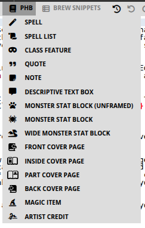

# 5. Player's Handbook snippets



**PHB** stands for **Player's Handbook**: the core fifth-edition Dungeons & Dragons player rulebook (the book with classes, spells, and equipment). Homebrewery’s **PHB** menu copies that look—parchment notes, spell write-ups, class features, monster frames, and cover pages—so a homebrew module can sit next to the official book without a layout app.

These snippets live under the book icon on the snippet bar (**PHB**), not under Text Editor. Text Editor still decides pages and columns; PHB decides the *game* blocks on those pages. Place the cursor, insert the snippet, then replace the joke placeholder names with your own. Leave the `{{ }}` wrappers and `::` definition lists; those are the visual structure.

Official D&D names and art are still Wizards of the Coast’s. You are responsible for what you publish.

### 5.1 Spell

**Menu:** PHB → **Spell**

Inserts a single spell write-up: name as `####`, italic school line, then **Casting Time**, **Range**, **Components**, and **Duration** as definition-list rows (`::` between label and value). Body paragraphs follow. That hanging-indent pattern is the same one the PHB uses.

```markdown
#### Tide Lantern
*2nd-level evocation*

**Casting Time:** :: 1 action
**Range:** :: Touch
**Components:** :: V, S, M (a pinch of dry salt)
**Duration:** :: Concentration, up to 1 hour

A flame, equivalent in brightness to a torch, springs from an object that you touch.
The effect looks like a regular flame, but it creates no heat and doesn't use oxygen.
```

There is **no** `{{spell}}` wrapper. The heading level and `::` rows are enough for the theme. Keep the school line italic. Put spells in a column, or wrap several in `{{wide}}` only if you are laying out a full-page appendix.

### 5.2 Spell List

**Menu:** PHB → **Spell List**  
**Inserts:** `{{spellList,wide ... }}`

A two-column, full-width list grouped by level (`##### Cantrips (0 Level)` through `##### 9th Level`) with bullet spell names. Use it on a class or subclass page under “Spell List.”

```markdown
{{spellList,wide
##### Cantrips (0 Level)
- Light
- Prestidigitation

##### 1st Level
- Fog Cloud
- Shield
}}
```

Delete levels the class does not get. Drop `,wide` (or wrap a narrower list) if you want the list in one column beside flavor text. The snippet fills itself with random joke names; replace every bullet.

### 5.3 Class Feature

**Menu:** PHB → **Class Feature**

Inserts the **opening spread** of a class chapter: “As a [class], you gain the following class features,” then Hit Points, Proficiencies, optional Spellcasting Ability, and Equipment. Definition lists again use `::`. Place this **after** your class table (the table itself is a **Tables** snippet, in a later chapter).

```markdown
## Class Features

As a tidewarden, you gain the following class features.

#### Hit Points
**Hit Dice:** :: 1d10 per tidewarden level
**Hit Points at 1st Level:** :: 10 + your Constitution modifier
**Hit Points at Higher Levels:** :: 1d10 (or 6) + your Constitution modifier per tidewarden level after 1st

#### Proficiencies
**Armor:** :: Light armor, medium armor, shields
**Weapons:** :: Simple weapons, martial weapons
**Tools:** :: Navigator's tools

**Saving Throws:** :: Strength, Wisdom
**Skills:** :: Choose two from Athletics, Perception, Survival, Insight
```

The snippet’s sample class names are jokes (`archivist`, `fancyman`). Rename everything before you share. After this block, add each numbered feature as a `###` heading and body text in the same chapter.

### 5.4 Quote

**Menu:** PHB → **Quote**  
**Inserts:** `{{quote ... }}` with nested `{{attribution ... }}`

A pull-quote in the PHB italic style, with author and work on the attribution line. Use it to open a chapter or break a long column of rules.

```markdown
{{quote
The sword glinted in the dim light, its edges keen and deadly.

{{attribution Eolande Blackwood, *The Blade of Destiny*}}
}}
```

Keep quotes short. Long quotations belong in a **Descriptive Text Box** if the GM should read them aloud.

### 5.5 Note

**Menu:** PHB → **Note**  
**Inserts:** `{{note ... }}`

The yellow (parchment) sidebar the PHB uses for asides, optional rules, and “this is interesting but not the main procedure.” Tables and lists work inside a note.

```markdown
{{note
##### Time to Drop Knowledge
Harbor Watch will ignore a bribe under 5 gp. They will not ignore a talking gull.
}}
```

### 5.6 Descriptive Text Box

**Menu:** PHB → **Descriptive Text Box**  
**Inserts:** `{{descriptive ... }}`

The green-gray read-aloud box. Use it for boxed text the DM recites when the party enters a room. Same inner Markdown as a note (headings, lists, tables); different job and color.

```markdown
{{descriptive
##### The Counting House
Salt and ink hang in the air. Two clerks freeze with quills raised. Behind them, a mastiff opens one eye.
}}
```

Do not put mechanical DCs inside a descriptive box unless the table wants to hear them. Mechanics belong in a **Note** or in the body.

### 5.7 Monster Stat Block (unframed)

**Menu:** PHB → **Monster Stat Block (unframed)**  
**Inserts:** `{{monster ... }}` with **no** `frame` class

Same stat layout as the framed block (name, type line, AC/HP/Speed, ability grid, traits, actions) without the heavy parchment border. Use it for an NPC in a town chapter, a simple beast in a sidebar, or when your own background art would clash with the frame.

Keep the `___` rules and `::` rows. You are only dropping the picture-frame chrome.

### 5.8 Monster Stat Block

**Menu:** PHB → **Monster Stat Block**  
**Inserts:** `{{monster,frame ... }}`

The default MM/PHB look: single column, textured frame, gold rules. Use it when the creature fits in one column (most ordinary stat blocks).

```markdown
{{monster,frame
## Pier Shade
*Medium undead, neutral evil*
___
**Armor Class** :: 13
**Hit Points** :: 22 (5d8)
**Speed** :: 30 ft., swim 30 ft.
___
|STR|DEX|CON|INT|WIS|CHA|
|:---:|:---:|:---:|:---:|:---:|:---:|
|6 (−2)|16 (+3)|10 (+0)|8 (−1)|12 (+1)|14 (+2)|
___
**Senses** :: darkvision 60 ft., passive Perception 11
**Languages** :: the languages it knew in life
**Challenge** :: 1 (200 XP) {{bonus **Proficiency Bonus** +2}}
___
***Sunlight Weakness.*** While in sunlight, the shade has disadvantage on attack rolls, ability checks, and saving throws.

### Actions
***Chilling Touch.*** *Melee Spell Attack:* +4 to hit, reach 5 ft., one target. *Hit:* 9 (2d6 + 2) necrotic damage.
}}
```

Replace sample numbers; leave `::`, `___`, and the ability table. Trait names use `***Name.***` The `{{bonus ...}}` chip on the Challenge line is part of the current snippet.

If the block is too tall: shorten flavor, move it higher in the column, or switch to the wide variant. Splitting with `___` mid-block is a last resort and a **fixed** break.

### 5.9 Wide Monster Stat Block

**Menu:** PHB → **Wide Monster Stat Block**  
**Inserts:** `{{monster,frame,wide ... }}`

The same framed block spanning **both** columns, like a large MM entry. Use it for legendary or lair-action creatures, or a full-width “poster” under a chapter heading.

`wide` restarts column flow after the block. Put story text after the closing `}}`, then add `\column` if you need to rebalance.

### 5.10 Front Cover Page

**Menu:** PHB → **Front Cover Page**  
**Inserts:** `{{frontCover}}` plus logo, title, subtitle, `{{banner HOMEBREW}}`, footnote, cover art, and a trailing `\page`

This is a full **physical** first sheet. Replace the title, subtitle, banner word, flavor footnote, and image URL. The snippet already ends with `\page`, so the next thing you type is page 2.

Pair it with **Skip Page Number** from Text Editor so the cover is not printed as folio 1. Cover snippets also flip left/right footer sides for the pages that follow.

```markdown
{{frontCover}}
{{skipCounting}}

{{logo }}

# Saltmarsh Gazetteer
## A Dockside Heist
___
{{banner HOMEBREW}}
```

You are responsible for cover-art licenses. The sample images are Homebrewery assets for testing.

### 5.11 Inside Cover Page

**Menu:** PHB → **Inside Cover Page**  
**Inserts:** `{{insideCover}}` with title, a center watercolor mask around art, logo, and `\page`

Use the sheet immediately behind the front cover: credits, “a book by,” or a second title treatment. Skip numbering here too if you do not want it in the published count.

### 5.12 Part Cover Page

**Menu:** PHB → **Part Cover Page**  
**Inserts:** `{{partCover}}` with `# PART X`, a subtitle, an edge-masked image, and `\page`

Drop this at the start of Part 2, Part 3, and so on in a long adventure. Change `PART X` and the subtitle. These sheets often skip the folio as well, then **Restart Numbering** only if you want each part to begin at page 1 (most modules keep one run of numbers).

### 5.13 Back Cover Page

**Menu:** PHB → **Back Cover Page**  
**Inserts:** `{{backCover}}` with a short blurb, a rule, a “for use with any fantasy roleplaying ruleset” line, art, and a white Homebrewery logo

This is the last physical page. Put your elevator pitch in the blurb paragraphs (`:` between them is vertical space). Add **Homebrewery Credit** from Text Editor if you want that badge as well as the logo already on this snippet.

### 5.14 Magic Item

**Menu:** PHB → **Magic Item**

A DMG-style item: `####` name, italic type/rarity/attunement line, then body text. Like **Spell**, there is no special wrapper—the heading and italics carry the style.

```markdown
#### Tide Lantern
*Wondrous item, uncommon (requires attunement)*
:
This brass lantern burns with cold salt-fire. While lit, it sheds bright light in a 20-foot radius in fog that would otherwise heavily obscure the area.
```

The lone `:` under the rarity line is a small gap before the description. Change rarity and attunement to match your table.

### 5.15 Artist Credit

**Menu:** PHB → **Artist Credit**  
**Inserts:** `{{artist,top:90px,right:30px ... }}`

A small caption block you pin on the page (cover art, a map, a full-page illustration). Set `top` / `right` / `left` / `bottom` so it sits on a quiet corner of the image. Include the work title and a link to the artist.

```markdown
{{artist,top:90px,right:30px
##### Bird with autumn foliage
[by L. Prang & Co.](https://www.loc.gov/resource/pga.14148)
}}
```

Add one credit per sourced image. This does not replace a license page; it is the on-page caption.
