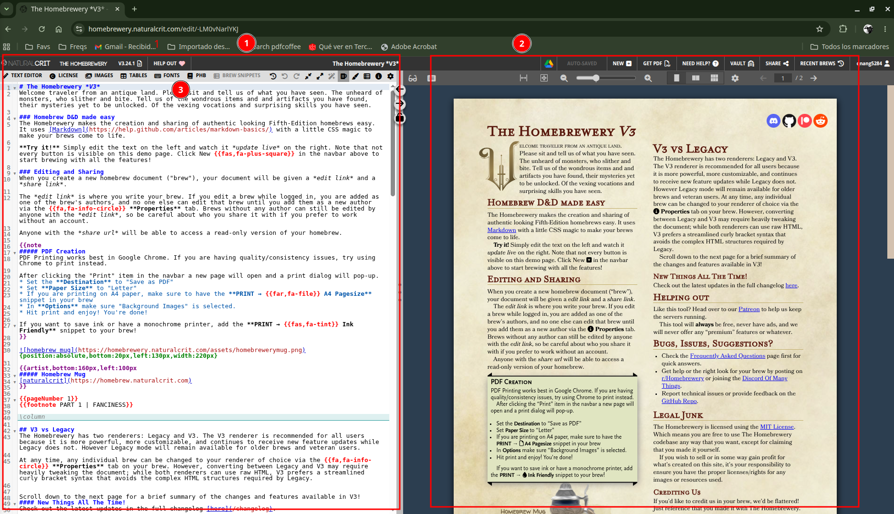

# 2. Start a new document

### 2.1 Open the editor

1. Go to [https://homebrewery.naturalcrit.com](https://homebrewery.naturalcrit.com).
2. Sign in with Google if you want the brew saved to your account (strongly recommended).
3. Start a new brew (Home / **New**, or [https://homebrewery.naturalcrit.com/new](https://homebrewery.naturalcrit.com/new)).
4. Keep the **V3** renderer for new work. Legacy still opens old documents; new snippets and styling live on V3.

### 2.2 Learn the workspace

| Area                    | What it does                                     |
| ----------------------- | ------------------------------------------------ |
| **Brew editor** **(1)** | Your Markdown source                             |
| **Preview** **(2)**     | Paginated pages as they will print               |
| **Snippet bar (3)**     | Inserts PHB blocks, tables, images, page numbers |

**Gentle advice:** save early, give the brew a real title, and write one short paragraph first. Confirm the preview updates before you add stat blocks. That single check saves a lot of “did I type in the wrong place?” confusion.

### 2.3 Use snippets instead of memorizing syntax

Place the cursor where the content should appear, then pick a snippet (for example **PHB → Monster Stat Block** or **Tables → …**). Homebrewery pastes a complete, valid example. Replace the placeholder names and numbers. You can always trim extra rows later.
