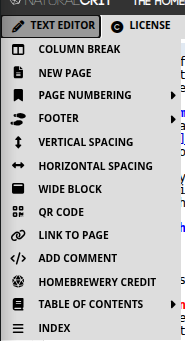

# 4. Text Editor

The **Text Editor** menu (pencil icon on the snippet bar) is the layout toolkit. These snippets do not draw monsters or class charts. They decide **where** text sits: pages, columns, numbers, footers, contents, and a few extras.



**How to use any of them**

1. Click in the brew where the control should go.
2. Open **Text Editor** and pick the snippet.
3. Homebrewery pastes the syntax at the cursor. Change placeholder words; leave the `\page`, `{{ }}`, and class names unless you know you need a different look.

`\pagebreak` and `\columnbreak` work as aliases of `\page` and `\column` if you are used to GM Binder.

### 4.1 Column Break

**Menu:** Text Editor → **Column Break**  
**Inserts:** `\column`

The default PHB page is **two columns**. Text fills the left column, then spills into the right. `\column` does **not** create extra columns. It **forces a break** at that point in the existing two-column flow.

```markdown
## The Counting House

Clerks shout over the clatter of coin.

\column

## The Vault Door

Two iron bars and a sleeping mastiff.
```

Use it when the next heading should start at the **top of the right column**, not halfway down the left. If text peeks off the right edge of the page, a third CSS column is overflowing: add **New Page**, shorten the copy, or move a tall block. Do not try to invent a third on-page column.

### 4.2 New Page

**Menu:** Text Editor → **New Page**  
**Inserts:** `\page`

Homebrewery **does not paginate for you**. A page grows until you tell it to stop. If text spills off the parchment, the preview is warning you—not failing.

`\page` is a **contextual** break: Homebrewery only honors it **alone, at the start of a line**. That rule keeps `\page` inside sentences or code examples from accidentally splitting your brew.

```markdown
The cultists scatter into the alleys.

\page

## Aftermath
When dawn reaches the docks, the ledger is gone.
```

**Rules**

- Put `\page` on its **own line**, with nothing before it on that line.
- Optional curly modifiers style the **next** page, for example `\page{wide}` or a class you defined in the Style tab.
- A counter can appear beside each `\page` line in the editor (counting from page 2). That number is a **map of physical pages**. It is not the printed folio unless you also add a page-number snippet.

Insert a break when a heading is stranded at the bottom of a column, a table is clipped, or a chapter should start on a fresh sheet. If content is only slightly over, shorten a paragraph before you add another page.

### 4.3 Page Numbering

**Menu:** Text Editor → **Page Numbering**

`\page` only starts a new sheet. The PHB-style digit in the bottom corner is a **separate** snippet. Place it on each page that should show a folio, usually just after the `\page` that begins that sheet (and on page 1, near the top of the brew).

#### Page Number (by hand)

**Inserts:** `{{pageNumber 1}}`

Type any label you want: `1`, `iv`, `A-3`. Homebrewery prints that text as the folio and does **not** update it when you insert pages. Use this for a one-pager, a preface in Roman numerals, or a spread that must say a fixed string.

```markdown
{{pageNumber iv}}
```


#### Auto-incrementing Page Number

**Inserts:** `{{pageNumber,auto}}`

Homebrewery counts physical pages and paints the digit on the outer corner (odd pages right, even pages left in the PHB theme). Put this snippet on **every** content page that should show a number.

```markdown
{{pageNumber,auto}}
```


#### Variable Auto Page Number

**Inserts:** `{{pageNumber $[HB_pageNumber]}}`

`$[HB_pageNumber]` is the built-in counter. It supports simple math and reassignment, so you can print a custom scheme in body text as well as in the footer. For everyday work this behaves like auto numbering with more room to grow.

```markdown
{{pageNumber $[HB_pageNumber]}}
```


#### Skip Page Number Increment this Page

**Inserts:** `{{skipCounting}}`

Put this on covers, inside covers, and credits sheets. That page prints **without** advancing the published count (and typically without a folio). The table of contents generator also ignores skipped pages when it maps heading → page number.

```markdown
{{skipCounting}}

# Saltmarsh Gazetteer
```


#### Restart Numbering

**Inserts:** `{{resetCounting}}`

Put this on the first real content page so that sheet becomes printed **1**, which is what a contents list should match. Combine it with an auto (or variable) page-number snippet on the same page.

```markdown
{{skipCounting}}

# Saltmarsh Gazetteer

\page

{{resetCounting}}
{{pageNumber,auto}}
```

**Practical pattern:** skip decorative sheets, restart on the first numbered page, prefer auto or `$[HB_pageNumber]` on every content page, and never type a digit on the `\page` line itself.

### 4.4 Footer

**Menu:** Text Editor → **Footer**  
**Inserts:** `{{footnote PART 1 | SECTION NAME}}`

The footer is the small running title next to the page number (chapter name, part name, or adventure title). Replace the placeholder. Keep it short; long footers collide with the digit.

**Footer from H1** through **Footer from H6** scan **upward from the cursor** for the most recent heading of that level and paste that heading’s text into the footnote. Place the cursor in the chapter you are numbering, then pick **Footer from H1** (or H2) instead of typing the name twice.

```markdown
{{pageNumber,auto}}
{{footnote THE DOCKS AT NIGHT}}
```

Add a footer **per chapter** (or per page if the running title changes), not after every paragraph. Cover-page snippets already flip left/right footer sides for facing pages; after a cover, check that page 1 of the body sits on the recto if you care about print imposition.

### 4.5 Vertical Spacing

**Menu:** Text Editor → **Vertical Spacing**  
**Inserts:** a line of four colons (`::::`)

Each colon is a small vertical gap. The snippet drops several at once so you can nudge a heading, note, or illustration down the column without empty paragraphs. Delete colons to tighten; add more (or extra `:` lines) to push content toward a natural column end when a hard `\column` would fight the PDF engine.

```markdown
## The Vault Door

::::

Two iron bars and a sleeping mastiff.
```


### 4.6 Horizontal Spacing

**Menu:** Text Editor → **Horizontal Spacing**  
**Inserts:** `{{width:100px}}` as an inline spacer

Use this between words, icons, or short phrases when you need a fixed gap that a normal space will not give you. Change `100px` to `1cm`, `2em`, or another length. This is not a column tool; for layout across the page, use **Column Break** or **Wide Block**.

```markdown
Name {{width:100px}} Signature _______________
```


### 4.7 Wide Block

**Menu:** Text Editor → **Wide Block**  
**Inserts:** a `{{wide ... }}` wrapper

Content inside spans **both columns**: chapter intros, large tables, and anything that looks crushed in a single column. After a wide block, flow returns to column one. Add `\column` if you need to rebalance the text that follows.

```markdown
{{wide
### Downtime in Saltmarsh

While the party recovers, each character may pursue one downtime activity from the table below.
}}
```

CSS columns can sit oddly around a wide strip. If the PDF drops a wide section to the bottom of the page, avoid a hard `\column` immediately above `{{wide` and prefer Chrome for export.

### 4.8 QR Code

**Menu:** Text Editor → **QR Code**  
**Inserts:** an image whose URL is a generated QR code

The snippet points at a QR service and encodes your brew’s **Share** link when the brew is saved. If the brew is still on `/new` (unsaved), it falls back to the Homebrewery home URL. Change the `data=` query to any URL: a battle map, a Patreon page, or a handout.

```markdown
 {width:100px;mix-blend-mode:multiply}
```

`mix-blend-mode:multiply` lets the code sit on parchment without a white box. Save the brew before you rely on the Share URL inside the code.

### 4.9 Link to page

**Menu:** Text Editor → **Link to page**  
**Inserts:** `[Click here](#p3) to go to page 3`

Each preview page has an id `p1`, `p2`, `p3`, … matching **physical** sheets (the same count as the editor’s `\page` map), not the printed folio after skip/restart. Change the number to the sheet you want. In the live brew and in many PDFs, the link jumps to that page.

```markdown
See the harbor map on [page 3](#p3).
```

Use this for “continued on page …” notes. For a contents list with dotted leaders and mapped numbers, use **Table of Contents** instead of hand-writing every `#p` link.

### 4.10 Add Comment

**Menu:** Text Editor → **Add Comment**  
**Shortcut:** `Ctrl+/` (or `Cmd+/`) wraps a selection

Comments are notes **for you**. They do not appear in the preview, the share view, or the PDF. Use them for balance reminders, art to-dos, or “do not print this sidebar yet.”

```markdown
<!-- TODO: replace this rumor table after playtest. -->
```

Do not put secrets you would not want in the brew source; comments still live in the file if someone opens the editor.

### 4.11 Homebrewery Credit

**Menu:** Text Editor → **Homebrewery Credit**  
**Inserts:** a `{{homebreweryCredits}}` badge with the Homebrewery name and link

Place it on a credits or back-cover page if you want to acknowledge the tool. Replace nothing required; you may move it with the usual position styles later. This is courtesy, not a license for the game content you wrote.

```markdown
{{homebreweryCredits
Made With

{{homebreweryIcon}}

The Homebrewery
[Homebrewery.Naturalcrit.com](https://homebrewery.naturalcrit.com)
}}
```


### 4.12 Table of Contents

**Menu:** Text Editor → **Table of Contents**  
**Inserts:** a generated `{{toc,wide}}` list from your headings

The generator reads **H1–H3** by default from the preview, maps each heading to a page using skip/restart, and pastes Markdown links with PHB-style leaders. Insert it **after** your headings exist, usually on its own early page. If you add chapters later, run the snippet again (or replace the old `{{toc,wide}}` block). It will not update live by itself.

```markdown
{{toc,wide
# Contents

- ### [{{ The Docks at Night}}{{ 1}}](#p3)
 - #### [{{ The Counting House}}{{ 2}}](#p4)
}}
```

**Include in ToC up to H3 / H4 / H5 / H6** wrap a region in `{{tocDepthH4 ... }}` (and similar) so headings in that region go deeper than the default H3. After you add a depth wrapper, **regenerate** the contents snippet.

You can also mark blocks so their headings are skipped or forced in: CSS `--TOC:exclude` or `--TOC:include` on a `{{block}}`. Monster titles and note headings are often excluded so they do not clutter the list. Prefer real `#` / `##` / `###` lines in the body; bold-only titles will not appear.

The list is `wide` and can flow across the two columns. You do not need a manual `\column` inside the ToC.

### 4.13 Index

**Menu:** Text Editor → **Index**  
**Inserts:** a sample `{{index,wide,columns:5;}}` with hanging entries

Unlike the ToC, the index is **not** generated from headings. You maintain the entries: headwords, subentries, and page numbers. Change `columns:5` if you want fewer or more columns. Alphabetize as you add terms. Update page numbers when you insert `\page` breaks, or wait until layout is frozen and pass through once.

```markdown
{{index,wide,columns:3;
##### Index
- Harbor
 - docks, 1
 - vault door, 2
- Ledger, 3
}}
```

Indent subentries with two spaces after the `-`. Use an en-dash for ranges (`26-27`). Place the index at the back of the brew.
